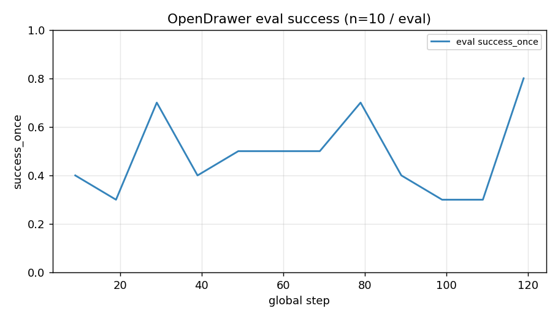
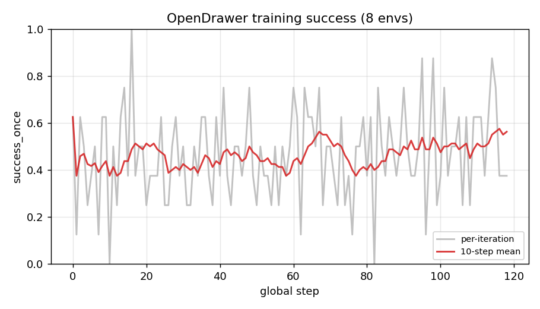
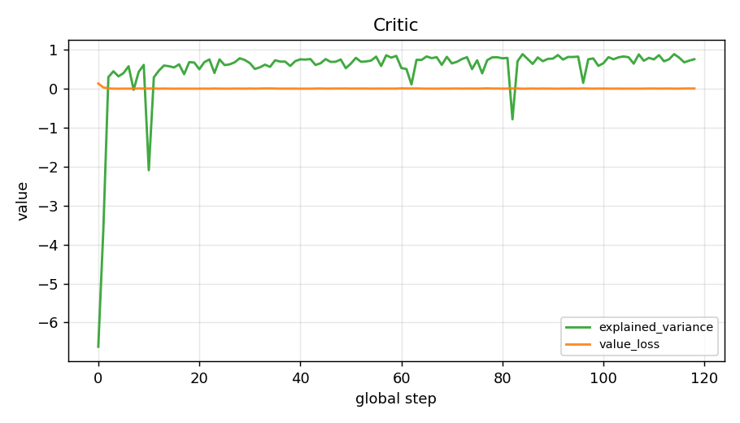
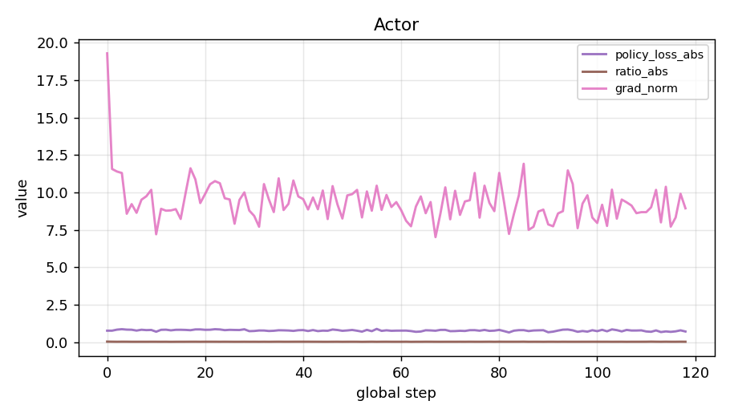

# 20261104_train_flowsde_opendrawer_pi05

**日期**: 2026-11-04 23:00 → 2026-11-05 05:50(6h50m)
**项目**: robocasa365
**类型**: train(含内置 eval)
**结论一句话**: 训练跑满 120 步,但**最后一步的 checkpoint 因磁盘写满而损坏**,可用的最好权重是 step_100;eval 数字全部只有 n=10,不足以判断"有没有提升"。

## 1. 目的

在 RoboCasa365 的 OpenDrawer 任务上,用 FlowSDE 在线微调
`pi05_pretrain_human300-75k`,看成功率能否高于同一权重的外部 baseline。

## 2. 实验设置

| 项 | 值 |
|---|---|
| 代码 | RLinf `0067f7d5`;robocasa365 `3443cdf3`;robosuite `5ce6643f` |
| 权重 | `pi05_robocasa365_openpi`(`/autodl-fs/data/artifacts/robocasa365/models/`) |
| 配置 | `examples/embodiment/config/robocasa365_flowsde_opendrawer_pi05.yaml` |
| 任务 | OpenDrawer(`atomic_seen`,pretrain split) |
| 训练环境 | 8 envs,`max_episode_steps=600`,`max_steps_per_rollout_epoch=600` |
| 评测环境 | 2 envs × `rollout_epoch=5` → **每次 eval 只有 10 条轨迹**,`use_fixed_reset_state_ids=True` |
| 总步数 | `max_steps=120`,`val_check_interval=10`,`save_interval=20` |
| 算法 | GAE、`gamma=0.99`、`gae_lambda=0.95`、clip 0.2、`lr=5e-6`、`value_lr=1e-4` |
| 采样 | `noise_method=flow_sde`,`num_steps=3`,`temperature_train=1.0`/`eval=0.6` |
| 批量 | micro 16 / global 480,FSDP no_shard,仅训练 action expert |
| 硬件 | 单卡,150G 本地盘 |

## 3. 结果

### 3.1 完成情况

| 项 | 结果 |
|---|---|
| 迭代数 | 119 次训练迭代(第 120 步的 ckpt 保存时崩溃) |
| 完整 ckpt | step 20 / 40 / 60 / 80 / 100 |
| 损坏 ckpt | **step 120**:只有 6.0G 的残缺 `__0_0.distcp`,缺少 `.metadata` 和 `full_weights.pt` |
| 崩溃原因 | `RuntimeError: [enforce fail at inline_container.cc:672]` ← **磁盘 100% 满**(150G 全被 6 个 16G ckpt 占满,剩 200K) |

### 3.2 eval 成功率(每 10 步,n=10)

| step | 9 | 19 | 29 | 39 | 49 | 59 | 69 | 79 | 89 | 99 | 109 | 119 |
|---|---|---|---|---|---|---|---|---|---|---|---|---|
| success_once | 0.4 | 0.3 | 0.7 | 0.4 | 0.5 | 0.5 | 0.5 | 0.7 | 0.4 | 0.3 | 0.3 | **0.8** |

均值 0.483,最高 0.80(最后一步),最低 0.30。

### 3.3 训练时成功率(8 envs,每步一条轨迹)

119 步均值 0.466,10 步滑动均值在 0.39–0.56 之间波动,无趋势。

### 3.4 优化器状态

| 指标 | 初期 | 末期 | 均值 |
|---|---|---|---|
| critic/explained_variance | -6.62 | 0.76 | 0.54 |
| critic/value_loss | 0.136 | 0.0085 | 0.0082 |
| actor/policy_loss | -0.073 | -0.143 | -0.199 |
| actor/policy_loss_abs | 0.765 | 0.710 | 0.777 |
| actor/ratio_abs | 0.034 | 0.027 | 0.026 |
| actor/clip_fraction | 0.0021 | 0.0000 | 0.0005 |
| actor/grad_norm | 19.3 | 8.94 | 9.36 |

## 4. 结论

1. **训练流程跑通了,但结果不可用。** 最后一步 ckpt 损坏,只剩 step_100;而 step_100 对应的 eval(step 99)是 **0.3**,不是最后一个 0.8。
2. **最后一个 0.8 不可信。** 它是 n=10 的 8/10,前一次是 3/10。n=10 下 0.3→0.8 完全在二项分布噪声范围内(95% CI 约 ±30pp)。**"最终成功率 0.8"这个结论不成立。**
3. **策略几乎没有更新。** `ratio_abs` 全程 ~0.026、`clip_fraction` ~0.0005,说明新旧策略的概率比几乎为 1;这是 `lr=5e-6` + 只训 action expert + 119 步的预期结果,但也意味着**这 120 步更像是预热,不足以产生可测的提升**。
4. **critic 确实学到了东西。** explained_variance 从 -6.6 升到 0.76,value_loss 降了两个数量级。价值头是有效的。
5. **指标记录有两个疑似 bug**(需要确认):
   - `eval/return` 与 `eval/success_once` **数值完全相同**,return 实际上没有独立计算;
   - `eval/episode_len` 恒为 600(因为 `ignore_terminations=True` + `auto_reset`),这个指标没有信息量。
6. **与外部 baseline 不可比。** 外部评测用的是 `episode_horizon_source=task_horizon` + `max_steps_per_rollout_epoch=1500` + n=48,而本次 eval 用 `max_episode_steps=600` + n=10。**两套口径下的数字不能相减。**

## 5. 下一步

1. **先复评测 step_100**:用与外部 baseline **完全相同的口径**(task_horizon、n≥48)跑一次,拿到可比的数字。这是回答"有没有提升"的唯一方法。
2. **修磁盘问题**:`save_interval=20` × 16G × 6 份 = 96G,必然爆盘。三选一:
   - `save_interval` 提到 50;
   - 加 `keep_last_n` 之类的清理;
   - ckpt 直接写到 `/autodl-fs/data/artifacts/`(容量大,但慢)。
3. **提高 eval 的 n**:`rollout_epoch` 5 × 2 env = 10 太少,至少 n=48,否则每 10 步只能看到噪声。
4. **查 `eval/return` 的日志 bug**。
5. 若确认策略更新幅度过小,再考虑提高 `lr` 或放开 `train_expert_only`。

## 6. 产物

| 类型 | 位置 |
|---|---|
| 完整 ckpt | `logs/<run>/.../checkpoints/global_step_{20,40,60,80,100}`(step_20/40、100 的 `full_weights.pt` 已归档到 `artifacts/robocasa365/ckpt/`) |
| 损坏 ckpt | step_120 已删除(无法使用) |
| 训练日志 | `projects/robocasa365/logs/20261104-23:00:07-...`(本地快盘) |
| 指标 | `metrics.json`(本目录) |
| 图 | `figures/` |
