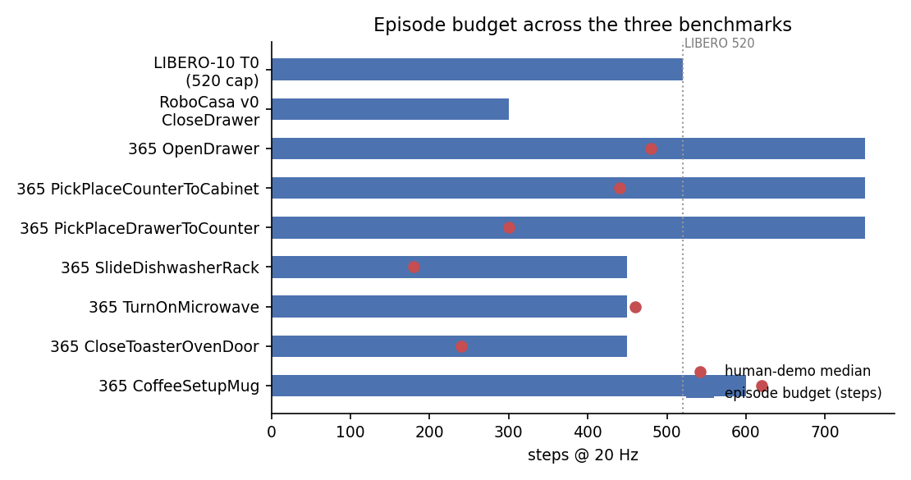
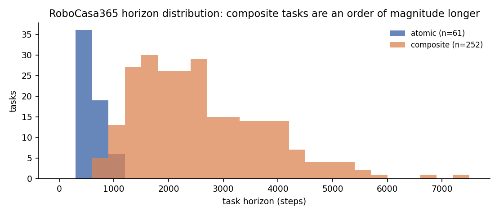
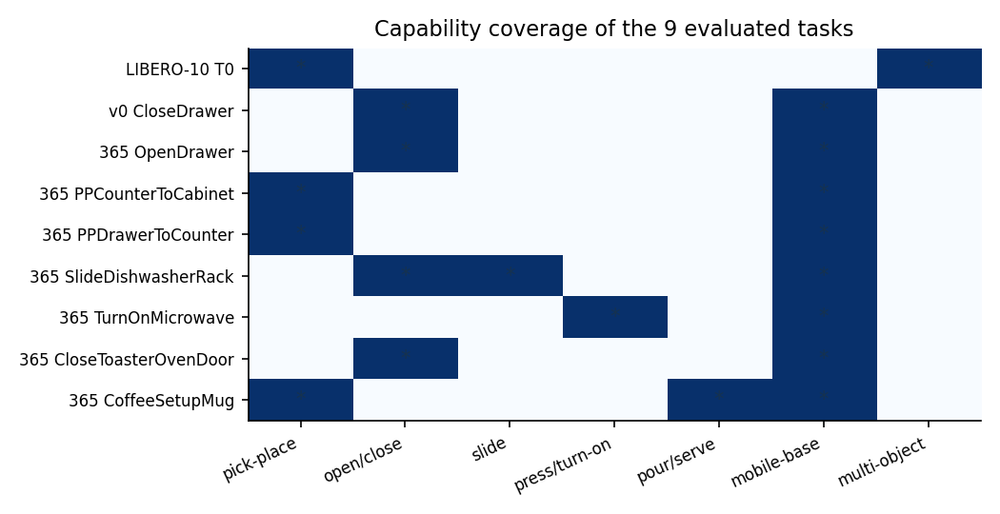
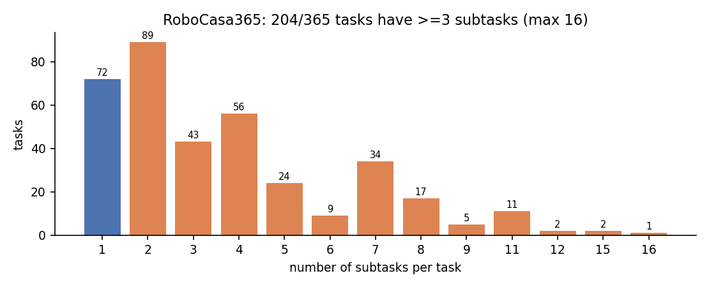

# 三个基准集的系统分析：LIBERO / RoboCasa v0.2 / RoboCasa365

**日期**：2026-11-05
**范围**：本项目实际跑过的 9 个任务 + 三个基准的全量任务池对照
**数据来源**：代码树、`dataset_registry.py`、官方 docs 元数据、本地 run 记录与日志

---

## 0. 一页结论

1. **三个基准不是"难度递增"，而是"维度递增"**。LIBERO 考的是**桌面短程多物体组合**（固定基座、520 步、8 物体）；
   RoboCasa v0 考的是**厨房单技能**（300 步、120 种场景组合、移动底盘）；
   RoboCasa365 考的是**厨房生态**（2 500 种场景、3 200+ 物体、65 原子 + 300 复合、248/365 需要移动基座）。

2. **你实际评测覆盖的是三个基准里最"短"的那一端**。9 个任务全部是单阶段任务：
   LIBERO Task 0 是 1 个目标条件、RoboCasa v0 `CloseDrawer` 是 1 个关节条件、365 的 7 个全部是 `atomic`（`num_subtasks=1`）。
   **365 的长程能力（300 个复合任务，中位 horizon 2 250 步，最长 7 200 步、16 个子任务）目前一条都没跑过。**

3. **决策点数量差 3 倍，且和"步数"不是一回事**：按你实际配置的执行块大小（5 步）换算，
   LIBERO 52 个决策点、v0 60 个、365 原子任务 90–150 个；而 365 复合任务的中位是 **450 个**、最长 **1 440 个**。
   RL 的信用分配难度由决策点数决定，不是由原始步数决定。

4. **发现两个 horizon 设置错误（官方元数据自带）**：`TurnOnMicrowave`（horizon 450 < 人类示范中位 460 步）和
   `CoffeeSetupMug`（600 < 620）。即使用人类策略，也基本不可能在预算内完成——这解释了它们为什么恒为 0，
   也说明这两个任务的 0 分**不能归因于策略**。

5. **你自己的训练/评测口径存在两处不可比**：FlowSDE 训练把 OpenDrawer 截断在 600 步（任务 horizon 是 750），
   且训练内 eval 用 `episode_horizon_source=max_episode_steps`；外部 eval 用 `task_horizon`。两组数字不能直接对比。
   `episode_len=600.0` 恒定就是这个原因，不是"模型总是跑满"。

6. **评测样本量普遍不足**：7 个任务里 6 个是 n=6。n=6 时 0/6 的 95% 置信上界约 39%，任何"任务太难"的结论都不成立。

---

## 1. 口径与标注

| 标注 | 含义 |
|---|---|
| **[F]** | 直接从代码/配置/日志读到的事实，附 `file:line` |
| **[D]** | 由 [F] 做算术推导（如 520 步 ÷ 10 = 52 个决策点） |
| **[E]** | 估算，来源已说明但无逐项精确统计 |
| **[!]** | 存在口径冲突或疑点，报告中已单列 |

统一约定：

- **步（step）** = 一次环境交互 = 一次控制指令，控制频率三个基准都是 **20 Hz** [F]。
- **决策点（decision point）** = 策略真正做一次前向推理并下发的次数。
  `决策点 = 回合预算(步) ÷ num_action_chunks`，其中 `num_action_chunks` 是每次推理实际执行的步数 [F]（`rlinf/workers/env/env_worker.py:160-171`）。
  **注意不要用 `action_horizon`（网络预测长度，三个基准分别是 10/50/50）来算决策点**——实际执行的只是前 `num_action_chunks` 步。
- **回合预算** = 环境里真正生效的截断值。三个基准的 robosuite 原生 horizon（LIBERO 1000、RoboCasa 1000）都被 `ignore_done=True` + 框架截断架空，不作为口径 [F]。

---

## 2. 三个基准的定位

| 维度 | LIBERO | RoboCasa v0.2 | RoboCasa365 |
|---|---|---|---|
| 任务总数 | **130**（spatial/object/goal 各 10 + libero_10 10 + libero_90 90）[F] | **25** 个单阶段任务（不含抽象基类）[F] | **365** = 65 原子 + 300 复合 [F] |
| 场景空间 | 1 个固定桌面布局 × 50 个初始状态 [F] | 10 布局 × 12 风格 = **120** 组合 [F] | 50 训练布局 × 50 训练风格 = **2 500** 组合；另有 10 个对角线 target 场景 [F] |
| 机器人 | Franka Panda，**固定基座** [F] | PandaOmron（Panda + Omron 移动底盘）[F] | PandaOmron [F] |
| 回合预算 | **520** 步 = 26 s [F/D] | **300** 步 = 15 s（框架截断）[F/D] | 原子 450–750 步；复合中位 **2 250** 步、最长 7 200 步 [F] |
| 决策点（chunk=5） | **104**；按训练口径 chunk=10 为 **52** [D] | **60** [D] | 原子 **90–150**；复合中位 **450** [D] |
| 动作空间 | 7 维（3 位移 + 3 旋转 + 1 夹爪）[F] | 12 维（6 位姿 + 1 夹爪 + 4 底盘 + 1 模式）[F] | 12 维（同左）[F] |
| 状态 | 8 维 [F] | 25 维原始 → 16 维策略输入 [F] | 25 → 16 [F] |
| 相机 | 2 路，256→224 [F] | 2 路渲染 / 5 个相机位，224 [F] | 3 个相机位 / 用 2 路，224 [F] |
| 成功判据 | 2 个目标条件（两个物体都要进篮子）[F] | 1 个（抽屉关节 ≤ 5%）[F] | 1–2 个 [F] |
| 时间跨度 | 秒级，单一桌面 | 10–20 秒，单一房间 | 10 秒（原子）→ **166 秒**（最长复合）[F] |
| 核心考点 | 指令跟随 + 多物体组合 | 灵巧操作 + 底盘协同 | 技能广度 + **长程组合** + 场景泛化 |

> 一句话：LIBERO 是"**看懂并做到两件事**"，RoboCasa v0 是"**做好一件事**"，RoboCasa365 是"**在陌生厨房里把一整套流程做完**"。



---

## 3. 实际跑过的 9 个任务

### 3.1 总表

| # | 基准 | 任务 | 预算(步) | 人类示范中位(步) | 决策点 | 子任务 | 判据数 | 机器人 | 已评测 n |
|---|---|---|---|---:|---:|---:|---:|---|---:|
| 1 | LIBERO-10 | Task 0 双物体入篮 | 520 | — | 52 | 1 | 2 | Panda（固定） | 20/60 |
| 2 | RoboCasa v0.2 | CloseDrawer | 300 | — | 60 | 1 | 1 | PandaOmron | 50 |
| 3 | 365 | OpenDrawer | 750 | 480 | 150 | 1 | 1 | PandaOmron | 50 |
| 4 | 365 | PickPlaceCounterToCabinet | 750 | 440 | 150 | 1 | 2 | PandaOmron | 6 |
| 5 | 365 | PickPlaceDrawerToCounter | 750 | 300 | 150 | 1 | 2 | PandaOmron | 6 |
| 6 | 365 | SlideDishwasherRack | 450 | 180 | 90 | 1 | 1 | PandaOmron | 6 |
| 7 | 365 | TurnOnMicrowave | 450 | 460 [!] | 90 | 1 | 2 | PandaOmron | 6 |
| 8 | 365 | CloseToasterOvenDoor | 450 | 240 | 90 | 1 | 1 | PandaOmron | 6 |
| 9 | 365 | CoffeeSetupMug | 600 | 620 [!] | 120 | 1 | 2 | PandaOmron | 6 |

机器可读版本：`tasks_run.csv`。人类示范中位数来自 `docs/atomic_tasks/atomic_episode_lengths.js`（任务级中位秒数 × 20 fps）[F]。

### 3.2 LIBERO-10 Task 0：唯一的"多物体组合"任务

- 任务：`LIVING_ROOM_SCENE2_put_both_the_alphabet_soup_and_the_tomato_sauce_in_the_basket`
- 场景：1 个 living-room 桌面布局，**50 个固定初始状态**（`.pruned_init`，123 维），每局随机抽一个 [F]
- 物体：8 个实例（2 个目标 + 5 个干扰 + 1 个篮子）+ 1 张桌子夹具；桌面可用区域约 0.53 × 0.55 m [F/D]
- 成功：`(In soup basket) ∧ (In sauce basket)`，两个条件必须同时满足 → **2 个判据** [F]
- 决策点：评测配置 chunk=10 → **52**；起始策略评测 chunk=5 → **104**。RECAP 训练用 chunk=10（52）[F/D]

**解读**：LIBERO Task 0 的难点不在回合长度（26 秒在三个基准里最短），而在**目标组合**：
两个物体、两个放置条件、且桌面有 5 个外观高度相似的干扰物。它测的是"语言指代 + 抓取顺序"，不测长程。

### 3.3 RoboCasa v0.2 CloseDrawer：把"一件事"做稳

- 单阶段任务，目标是一个**随机选侧**的 top drawer；重置时抽屉打开 90–100% [F]
- 成功：抽屉滑动关节 `≤ 0.05`，即 ≤5% 开度，**1 个判据** [F]
- 场景：10 布局 × 12 风格 = 120 组合随机采样；单房间厨房；约 36–113 个夹具（估）+ 2–4 个可动物体 [F/E]
- 观测：2 路 224×224（左外视角 + 腕部）；12 维动作含底盘与躯干；状态 25→16 维 [F]
- 实测：成功回合 75–295 步，失败回合全部顶满 300 步 [F]

**解读**：这是三个基准里**最短**的任务（15 秒、60 决策点），但动作空间最大（12 维含底盘）。
它测的是"articulation 的精细控制"，不是组合能力。训练侧 horizon 用 300 而非环境原生 1000，属于人为加难 [F]。

### 3.4 RoboCasa365 七个原子任务：广度够，深度没有

七个任务全部来自 `TARGET_TASKS["atomic_seen"]`，`num_subtasks=1`，覆盖 5 类操作技能：
开抽屉 / 抓放（两个方向）/ 滑架 / 按开关 / 放置+对准。

| 任务 | 技能本质 | 成功判据 | 观察 |
|---|---|---|---|
| OpenDrawer | 拉出抽屉到 ≥95% | 关节 ≥0.95 | 与 v0 CloseDrawer 是同一技能的正反向，**可直接对标** |
| PickPlaceCounterToCabinet | 抓→放进柜 | 在柜内 ∧ 夹爪远离 | n=6 得 1.0，**需先排除泄漏** |
| PickPlaceDrawerToCounter | 抓→放到台面 | 台面接触 ∧ 夹爪远离 | 唯一标 `moma_required=Yes` 的任务 |
| SlideDishwasherRack | 拉出碗架 | 架位 ≥0.95 或 ≤0.05 | n=6 得 1.0，同样可疑 |
| TurnOnMicrowave | 按启动键 | 已开机 ∧ 手指离键 | **预算 < 人类中位**，见 §7 |
| CloseToasterOvenDoor | 关门 | 门角 ≤0.005 | 判据极严（0.5°），可能过难 |
| CoffeeSetupMug | 放杯到咖啡机托盘 | 托盘对位（xy<4cm, |z|<10cm）∧ 夹爪远离 | **预算 < 人类中位**，且判据含 4 cm 容差 |

### 3.5 关于 365 评测数字的三点提醒

- **n=6 的 0 分不是证据**。0/6 的 95% 置信上界约 39%；要区分"成功率 20%"和"成功率 0%"至少需要 n≈30。
- **两个 1.0 先查泄漏**：`PickPlaceCounterToCabinet` 和 `SlideDishwasherRack` 在 n=6 下全成功，
  而同批任务大多为 0，分布不像真实难度曲线。
- **OpenDrawer 三次结果 0.417 / 0.167 / 0.20 不可比**：前两次来自 `/root/autodl-tmp/RLinf` 旧 checkout，
  失败回合被截在 599–600 步；后一次是当前 750 步 horizon 的 n=50。**换代码路径后评测数字不能接续使用。**

---

## 4. 决策点：比"步数"更该看的量

RL 里真正贵的是"要做多少次决策"，因为它同时决定信用分配长度和每回合的采样成本：

```
决策点/回合 = 回合预算(步) ÷ num_action_chunks
单次迭代转移数 = 并行环境数 × 决策点/回合
```

| 配置 | 预算 | chunk | 决策点/回合 | 8 env 一次 rollout 的转移数 |
|---|---:|---:|---:|---:|
| LIBERO Task 0（训练口径） | 520 | 10 | **52** | 416 |
| LIBERO Task 0（chunk=5 复评） | 520 | 5 | 104 | 832 |
| v0 CloseDrawer | 300 | 5 | **60** | 480 |
| 365 原子（450 步档） | 450 | 5 | **90** | 720 |
| 365 原子（600 步档） | 600 | 5 | 120 | 960 |
| 365 原子（750 步档） | 750 | 5 | **150** | 1 200 |
| 365 复合（中位） | 2 250 | 5 | **450** | 3 600 |
| 365 复合（最长 DivideBuffetTrays） | 7 200 | 5 | **1 440** | 11 520 |

**三个直接结论**：

1. 你现在的评测全部落在 **52–150 个决策点**区间——这是"短程 RL"的范畴，GAE(λ=0.95)、γ=0.99 的信誉分配跨度足够。
2. 一旦上 365 复合任务（450 决策点起步），**同样的 γ 和 GAE 参数会失效**，需要重新调折扣或做分层/子任务回报。
3. 采样成本按决策点线性增长：同样 8 个环境，跑复合任务的单步开销是原子任务的 3–10 倍。这是"365 上做 RL 很贵"的**结构性原因**，不是工程 bug。

---

## 5. 环境规模

| 项 | LIBERO | RoboCasa v0.2 | RoboCasa365 |
|---|---|---|---|
| 场景/布局数 | 1 布局，50 初始状态 | 10 布局 × 12 风格 | 50 × 50 = 2 500（pretrain）；10 target |
| 每局可动物体 | 8 + 1 夹具 | 2–4（1 目标 + 1–3 干扰） | 2–4（原子）；复合更多 [E] |
| 场景夹具数 | 桌面 1 个 | ≈36–113 [E] | 同类 [E] |
| 物体资产池 | 数十（LIBERO 固定集） | 中（RoboCasa v0 资产） | **3 200+ 物体 / 150+ 类别** [F] |
| 是否多房间 | 否（单桌面） | 否（单间厨房） | 否（单间厨房，50 个布局各有 1 个 room）[F] |
| 相机位 / 使用 | 2 / 2 | 5 / 2 | 3 / 2 |
| 分辨率 | 256 → 224 | 224 | 224 |
| 动作维度 | 7 | 12 | 12 |
| 状态维度 | 8 | 25 → 16 | 25 → 16 |

**要点**：365 的"大"体现在**组合空间**（2 500 场景 × 365 任务），不是单场景复杂度。
单场景仍然是**单间厨房**，物体数量与 v0 同量级。所以"环境有多大"应该分两问：
**单局状态空间**（三个基准差别不大）与**任务×场景覆盖**（365 高两个数量级）。



---

## 6. 能力覆盖



**已覆盖（9 个任务）**：

- 抓取-放置（4 个任务，含柜内/台面两种目标）
- articulation 开/关（4 个任务：抽屉、柜门、烤箱门、碗架）
- 按压/开关（1 个）
- 放置对准 / 倒液位姿（1 个）
- 移动底盘（7 个任务物理上具备，但仅 `PickPlaceDrawerToCounter` 标为必需）

**完全未覆盖**：

| 能力 | 365 中的规模 | 现状 |
|---|---|---|
| 长程多阶段组合 | **300 个复合任务**，204 个 ≥3 子任务，最长 16 子任务 | 0 个跑过 |
| 跨任务技能组合（如"煮→装盘→上桌"） | 60 个活动类别 | 0 个 |
| 场景泛化（target 场景） | 10 个对角线场景 + 32 个 target 任务 | 0 个 |
| 导航为主 | 原子任务中 1 个（NavigateKitchen）+ 大量 MoMA 任务 | 0 个 |
| 工具使用 / 双手协同 | 少数复合任务 | 0 个 |

**覆盖率一句话**：你已完成 **9 / 495**（三基准任务池合计约 495 个任务），
其中 365 完成 **7 / 365 ≈ 1.9%**，且全部集中在 65 个原子任务里最简单的一端。



---

## 7. "365 = 长程"这个判断需要修正

你的直觉方向是对的，但**精确说法**是：

> RoboCasa365 的**长程能力在 300 个复合任务里**，而 65 个原子任务与 RoboCasa v0 同源、长度相当甚至更短。
> 你评测的 7 个恰好全部是原子任务，所以**目前的数据完全不能反映 365 的长程特性**。

证据：

- 原子任务 horizon 中位 **450** 步（15–52 秒），与 v0 的 300 步同一量级 [F]
- 复合任务 horizon 中位 **2 250** 步（≈112 秒），是原子的 **5 倍**；最长 7 200 步（166 秒）[F]
- 复合任务人类示范中位 940 步，是原子任务（≈300 步）的 3 倍 [F]
- 复合任务里 204/365 有 ≥3 个子任务，`DivideBuffetTrays` 有 16 个 [F]

**这条修正很重要**：如果你在报告或对外表述里写"我们在 RoboCasa365 上评测"，别人会默认你覆盖了长程复合任务。
实际只跑了原子端，应当明确写成"RoboCasa365 atomic_seen 子集"。

---

## 8. 对后续训练/评测的具体建议

### 8.1 立刻要修的口径问题（P0）

| 问题 | 证据 | 建议 |
|---|---|---|
| 训练回合 600 步 vs 任务 horizon 750 | `robocasa365_flowsde_opendrawer_pi05.yaml:79` 训练块 `max_steps_per_rollout_epoch=600`，而 `episode_horizon_source=task_horizon` | 训练与外部评测统一到 750，或明确声明"训练在 600 步截断" |
| 训练内 eval 用 `max_episode_steps`，外部用 `task_horizon` | 训练 yaml `:98` vs 评测 yaml `:51` | 统一为 `task_horizon`，否则 `episode_len=600.0` 恒定会被误读 |
| chunk 口径混用（10 / 5） | LIBERO 训练 chunk=10、复评 chunk=5 | 复评必须用与训练相同的 chunk，否则决策点数 52 vs 104 不可比 |
| eval n 过小 | 6 个任务 n=6 | 至少 n=30；论文级结论 n=50（365 官方评测协议就是 50 个 rollout）[F] |
| reset 状态不固定 | 部分 run 用 `use_fixed_reset_state_ids=True`，部分不用 | 固定 reset 集合，否则同任务不同 n 的结果会像 OpenDrawer 那样漂移 |

### 8.2 两个"不可能任务"的特殊处理（P1）

`TurnOnMicrowave`（450 < 460）和 `CoffeeSetupMug`（600 < 620）的预算短于人类示范中位数。
建议：

- 要么按 1.5× 人类中位重设预算（如 700 / 950），
- 要么在报告中明确标注"这两个任务的人类成功率本身 < 50%"，
- 不要把它们和其它任务放在同一张成功率表里比较。

### 8.3 补测路线（按性价比排序）

| 优先级 | 动作 | 理由 |
|---|---|---|
| **P0** | 在 `composite_seen` 里挑 3 个 3–4 子任务的任务跑通评测 | 用最小成本把"长程"这一维补上，验证 450 决策点下的管线 |
| **P1** | 固定 seed + n=50 重跑 7 个原子任务的 baseline | 现有 n=6 数字不可用，后面所有训练对比都缺基准 |
| **P1** | 修 600/750 口径后重跑 OpenDrawer | 让 FlowSDE 的训练内数字与外部数字可比 |
| **P2** | `composite_unseen` 做泛化评测 | 这是 365 相对 v0 的核心卖点（未见场景 + 未见任务） |
| **P3** | 选 1–2 个 `moma_required=Yes` 的任务做底盘协同 | 12 维动作里的底盘通道目前没有任何证据表明被用起来了 |

---

## 9. 附录

### A. 文件清单

| 文件 | 内容 |
|---|---|
| `tasks_run.csv` | 实际跑过的 9 个任务，全字段 |
| `task_pool_robocasa365.csv` | 365 个任务：activity / 子任务数 / MoMA / 示范中位 / horizon / 决策点 / 能力标签 |
| `task_pool_libero.csv` | LIBERO 130 个任务（5 个 suite） |
| `task_pool_robocasa_v0.csv` | RoboCasa v0 的 34 个类定义（含抽象基类） |
| `figures/fig1_episode_budget.png` | 回合预算 vs 人类示范中位 |
| `figures/fig2_horizon_distribution.png` | 365 原子 vs 复合 horizon 分布 |
| `figures/fig3_subtasks.png` | 365 子任务数分布 |
| `figures/fig4_capability_matrix.png` | 9 个任务的能力覆盖矩阵 |

### B. 全量任务池统计

| 统计项 | 值 |
|---|---|
| RoboCasa365 任务总数 | 365（65 原子 + 300 复合，覆盖 60 个活动类别） |
| 有预训练数据的任务 | 300（65 原子 + 235 复合） |
| 有 target 数据集的任务 | 32（16 `composite_seen` + 16 `composite_unseen`） |
| 需要移动基座（MoMA） | **248 / 365**（67.9%） |
| 子任务数 ≥3 / ≥5 | 204 / 105 |
| 原子 horizon | 300–1050，中位 450 |
| 复合 horizon | 600–7200，中位 **2250** |
| 复合示范中位 | 200–3320 步，中位 940 |
| LIBERO 任务总数 | 130（libero_90 占 90） |
| RoboCasa v0.2 任务数 | 25 个单阶段任务 |

### C. 主要证据位置

| 结论 | 来源 |
|---|---|
| LIBERO 520 步、chunk=10、50 init | `evaluations/libero/libero_10_task0_cfg_pi05_eval.yaml:42-65` |
| v0 300 步截断、chunk=5 | `examples/embodiment/config/env/robocasa_closedrawer.yaml:16-17`、`robocasa_closedrawer_ppo_openpi_pi05.yaml:122` |
| 365 horizon 表 | `robocasa/utils/dataset_registry.py`（AST 解析 313 条 horizon） |
| 365 示范中位 | `docs/atomic_tasks/atomic_episode_lengths.js`、`docs/composite_tasks/composite_episode_lengths.js` |
| 365 子任务/MoMA | `docs/composite_tasks/task_attributes.json` |
| 场景 2 500 组合 | `robocasa/utils/env_utils.py:91-94`、`docs/assets/scenes.md:4` |
| 训练 600 步 | `examples/embodiment/config/robocasa365_flowsde_opendrawer_pi05.yaml:79` |
| 评测 750 步 / n=50 | `evaluations/robocasa365/robocasa365_eval_pi05.yaml:51` |

> **数据可信度说明**：所有"步数/horizon/子任务数/场景数"均为代码或官方元数据 [F]；
> 夹具数量（36–113）与复合任务单局物体数为 [E]；
> LIBERO 实测回合长度**无本地日志**（RECAP 的 60 条轨迹日志与数据集均已清理），故只给预算上限，不给均值。
